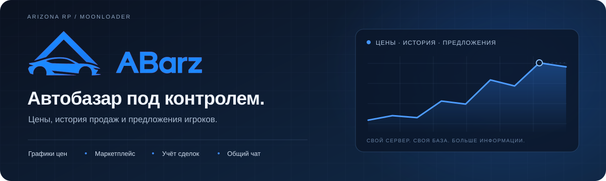

<p align="center">
  
</p>

<p align="center">
  <a href="https://github.com/andergr0ynd/autoabarz/releases/latest/download/autoabarz.lua"></a>
  &nbsp;
  <a href="https://github.com/andergr0ynd/autoabarz/releases/latest/download/abarz1.6.lua"></a>
  &nbsp;
  <a href="https://www.blast.hk/threads/257682/"></a>
</p>

<p align="center">
  <strong>Версия 1.9.10</strong> · Windows · Arizona RP · MoonLoader<br>
  Средние цены и графики, предложения других игроков, тюнинг и учёт сделок — в одном меню.
</p>

<p align="center">
  <a href="#install">Установка</a> &nbsp;·&nbsp;
  <a href="#features">Возможности</a> &nbsp;·&nbsp;
  <a href="#commands">Команды</a> &nbsp;·&nbsp;
  <a href="#faq">Вопросы</a> &nbsp;·&nbsp;
  <a href="https://github.com/andergr0ynd/autoabarz/releases/latest">Что нового</a> &nbsp;·&nbsp;
  <a href="https://www.blast.hk/threads/257682/">Тема на Blast</a>
</p>

---

## Выбери свою сборку

| | **AutoABarz** | **ABarz 1.6** |
| :--- | :--- | :--- |
| Файл | [**autoabarz.lua**](https://github.com/andergr0ynd/autoabarz/releases/latest/download/autoabarz.lua) | [**abarz1.6.lua**](https://github.com/andergr0ynd/autoabarz/releases/latest/download/abarz1.6.lua) |
| Возможности | Все функции ABarz | Те же функции |
| Обновление самого скрипта | Проверка GitHub и загрузка новой версии | Замена файла вручную |
| Загрузка библиотек ABarz | Автоматически | Автоматически |
| Кому подойдёт | Хочешь получать обновления через скрипт | Хочешь сам выбирать момент обновления |

Готовые комплекты с библиотеками: [AutoABarz — ZIP](https://github.com/andergr0ynd/autoabarz/releases/latest/download/AutoABarz-1.9.10.zip) · [ABarz 1.6 — ZIP](https://github.com/andergr0ynd/autoabarz/releases/latest/download/ABarz-1.6-1.9.10.zip).

> [!IMPORTANT]
> Устанавливай **только один** из этих файлов. Обе сборки используют общие настройки и выполняют одну и ту же работу.

## Новое в 1.9.10

- Обе сборки автоматически скачивают все семь библиотек ABarz, включая мост, и подключают его к установленному Arizona Market 3.57.

- Качество машины автоматически подхватывается через `/cars` после успешного выставления и передаётся в лот.
- Установленный тюнинг показывает цены и игровые миниатюры с увеличением при наведении. Иконки читаются из игрового архива в память; массовой распаковки и отдельной библиотеки декодера нет.
- Цена лота отображается вместе с комиссией 4%. Каталог автоматически обновляется раз в три минуты; ручное обновление и выбор сервера доступны сразу.
- Исправлены дубли при быстрой замене одинаковых машин и повторном использовании сервером табличек.
- `/abprice` и `/carprice` открывают поиск машины в основном меню; без названия показывается подсказка.

Мост Arizona Market скачивается автоматически вместе с остальными библиотеками. Если установлен оригинальный Arizona Market 3.57, скрипт подключает мост с сохранением оригинала; ручной установщик не нужен. Для цен деталей откройте `/crr` и выберите Vice City. Для обычных серверов используется приблизительный коэффициент ×100. У предметов с рейтингом стоимость может отличаться. [Подключение моста и состав комплектов](PUBLISH.md).

<a id="install"></a>

## Установка за три шага

**1. Подготовь MoonLoader.** Нужны установленные **mimgui**, **effil** и **SAMP.Lua**, а также стандартные библиотеки твоей сборки MoonLoader. [Подробнее о зависимостях ↓](#dependencies)

**2. Скачай один Lua-файл** из таблицы выше и положи в папку игры:

```text
Arizona RP/
└── moonloader/
    └── autoabarz.lua        ← или abarz1.6.lua, только один файл
```

Кнопки GitHub скачивают готовый `.lua`-файл. Кнопка **«Скачать с Blast.hk»** открывает тему ABarz на форуме, где можно скачать опубликованные там файлы.

**3. Зайди в игру и введи `/abarz`.** При первом запуске скрипт скачает недостающие библиотеки ABarz и один раз перезапустится. Дождись завершения загрузки.

> [!TIP]
> По умолчанию **F3** открывает меню, **F5** — чат. Удерживай **Alt**, чтобы пользоваться мышью в чате. Клавиши и масштаб интерфейса меняются в **Настройки → Клавиши / Интерфейс**.

<a id="features"></a>

## Что умеет ABarz

| Возможность | Что получаешь |
| :--- | :--- |
| **Цены и история** | Сканирование системных средних цен, таблица по дням, количество продаж и график изменения цены. |
| **Маркетплейс игроков** | Предложения пользователей ABarz с выбором сервера. Можно посмотреть машину, не приезжая на автобазар. |
| **Карточка автомобиля** | Цена, продавец, Twin Turbo и доступные сведения о тюнинге. Компактная фотография увеличивается при наведении. |
| **Тюнинг перед продажей** | Скрипт открывает инвентарь и вкладку транспорта для считывания деталей. В объявлении список раскрывается по нажатию. |
| **Техпаспорт** | Средняя цена из базы, а при определённой цене лота — сравнение с ней. |
| **Сделки и уведомления** | Учёт покупок и продаж, свои лоты и уточнение неоднозначных сделок. Уведомления о найденных предложениях. |
| **Общий чат и обмен базой** | Чат пользователей на своём сервере и передача базы цен с кнопкой скачивания. |

### Каждый сервер — отдельно

У каждого сервера своя база средних цен. Переключение сервера не перезаписывает цены другого сервера. Подключения по домену и числовому IP объединяются в один каталог и чат.

**Vice City** находится первым в списке серверов. Системных средних цен там нет: скрипт показывает доступные предложения по табличкам транспорта, не подставляя средние цены обычных серверов.

<a id="commands"></a>

## Команды под рукой

| Команда | Действие |
| :--- | :--- |
| `/abarz` | Открыть или закрыть главное меню |
| `/abscan` | Запустить сканирование, когда открыт список средних цен автобазара |
| `/abprice название` | Найти среднюю цену машины в своей базе |
| `/carprice название` | Второй вариант команды поиска цены |
| `/abchat` | Включить или выключить чат ABarz |
| `/abupdate` | Проверить обновление — **только в AutoABarz** |

**Первое сканирование:** на обычном сервере открой на автобазаре список «Средняя цена автомобилей», нажми «Начать сканирование» или введи `/abscan`. Дождись окончания — результат сохраняется автоматически.

<a id="faq"></a>

## Вопросы, которые возникают чаще всего

<details>
<summary><strong>Нужно ли вручную скачивать библиотеки из lib?</strong></summary>

Обычно нет. Начиная с **1.9.7**, обе сборки сами устанавливают:

- `notifications.lua`;
- `arizona-cef-dialogs.lua`;
- `arizona-events/init.lua`, `core.lua`, `bitstream.lua` и `subprocess.lua`;
- с **1.9.10** — `abarz-market-bridge.lua` с автоматическим подключением к Arizona Market 3.57.

Сначала используется GitHub, затем резервный адрес. Перед установкой проверяются Lua-код и необходимые признаки реализации. После установки комплекта выполняется один перезапуск.

Если загрузка не удалась, проверь интернет и перезагрузи скрипт. Запасной способ — скопировать [папку lib](lib) в `moonloader/lib` вручную.

</details>

<details>
<summary><strong>Почему я не вижу объявления другого игрока?</strong></summary>

Проверь, что у продавца установлена актуальная версия ABarz, выбран нужный сервер и фильтр **«Все лоты»**. Каталог содержит предложения пользователей скрипта, а не все машины игрового сервера.

Открытый каталог обновляется примерно раз в **10 секунд**. Выбор сервера и кнопка «Обновить каталог» запускают приоритетный запрос. При сетевой ошибке показываются ещё активные объявления из кеша.

При потере связи с продавцом объявление исключается после истечения срока активности — до **5 минут**. Это не мгновенная синхронизация. Доступность сервиса зависит от сети.

</details>

<details>
<summary><strong>Как обновить скрипт?</strong></summary>

**AutoABarz:** введи `/abupdate` или открой **Настройки → Обновления**. Там же можно включить проверку после входа в игру. После загрузки следуй уведомлению о перезагрузке.

**ABarz 1.6:** скачай новый `abarz1.6.lua`, замени старый файл и перезагрузи скрипты. Самообновления в этой сборке нет, автоматическая установка библиотек работает.

</details>

<details>
<summary><strong>Где лежат цены и что можно передавать друзьям?</strong></summary>

Базы разных серверов находятся в `moonloader/config/abarz/prices/`. Обмен базами доступен в меню ABarz. Ссылка действует **7 дней** после загрузки; повторная загрузка обновляет содержимое по той же ссылке. База другого сервера не импортируется в текущую.

Другим игрокам передавай **Lua-файл**, а не свою папку `config`. Файл `config/abarz/cloudflare-device.json` содержит персональный ключ устройства. Каждая установка получает свой ключ автоматически.

Ники и характеристики в маркетплейсе передаются скриптом продавца. Это не подтверждение аккаунта Arizona игровым сервером.

</details>

<a id="dependencies"></a>

<details>
<summary><strong>Зависимости и структура файлов</strong></summary>

**Нужны заранее:** MoonLoader, [mimgui](https://github.com/THE-FYP/mimgui), совместимая с MoonLoader библиотека effil и [SAMP.Lua](https://github.com/THE-FYP/SAMP.Lua).

Также используются стандартные модули LuaJIT / сборки MoonLoader: `ffi`, `bit`, `encoding`, `json`, `vector3d`, `socket.http`, `ssl.https` и `ltn12`. Загрузчик ABarz не устанавливает весь MoonLoader и его бинарные зависимости.

**Скачивается автоматически:** комплект из семи Lua-файлов в [lib](lib) и [логотип](images/abarz-logo.png).

```text
moonloader/
├── autoabarz.lua                  # либо abarz1.6.lua
├── lib/
│   ├── notifications.lua
│   ├── arizona-cef-dialogs.lua
│   ├── abarz-market-bridge.lua
│   └── arizona-events/
│       ├── init.lua
│       ├── core.lua
│       ├── bitstream.lua
│       └── subprocess.lua
├── images/
│   └── abarz-logo.png
└── config/abarz/                  # создаётся автоматически
```

Корневая папка `arizona-events/` в репозитории сохранена для загрузчиков старых версий. Для ручной установки используй файлы из `lib/arizona-events/`.

Чат, каталог и обмен базами работают через Cloudflare Workers + D1. Ключи аккаунта Cloudflare в Lua не включены. Бесплатные квоты сервиса конечны.

</details>

---

### Нужна помощь или нашёл ошибку?

[**Сообщить об ошибке →**](https://github.com/andergr0ynd/autoabarz/issues/new?template=bug_report.yml) · [Обсуждение на Blast](https://www.blast.hk/threads/257682/) · [История обновлений](https://github.com/andergr0ynd/autoabarz/releases/latest)

При обращении укажи версию скрипта, сервер, действия перед ошибкой и текст ошибки из `moonloader.log`.

<sub>Автор скрипта — pechkin · arizona-cef-dialogs — XRLM · Спасибо авторам используемых библиотек.</sub>
